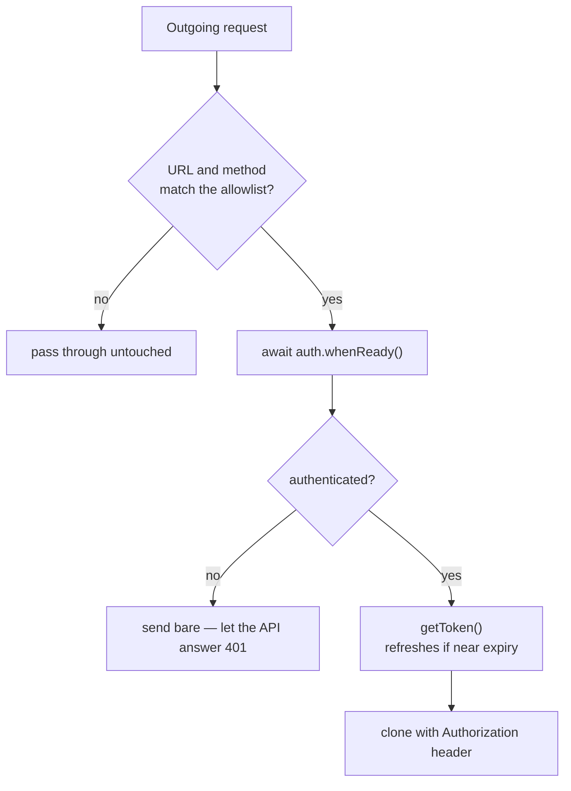

# Attaching tokens to requests

Register the interceptor once and your services never mention tokens again:

```ts title="src/app/app.config.ts"
provideHttpClient(withInterceptors([authTokenInterceptor]));
```

```ts title="src/app/order.service.ts"
@Injectable({ providedIn: 'root' })
export class OrderService {
  private readonly http = inject(HttpClient);

  list(): Observable<Order[]> {
    // `Authorization: Bearer …` is added on the way out.
    return this.http.get<Order[]>('/api/orders');
  }
}
```

## What it does per request



Two of those branches are deliberate choices rather than obvious ones.

**It waits for readiness.** A request fired during startup — a component loading
data on init — would otherwise go out unsigned while the session was still being
restored, and come back `401` even though the user was signed in.

**Unauthenticated requests go out bare.** The interceptor doesn't reject them.
Rejecting would turn "not signed in yet" into a client-side exception in code that
was only asking for data; letting the API answer `401` keeps the failure in one
place, where your error handling already lives.

## The allowlist

By default only same-origin, relative `/api/*` requests are signed:

```ts
urlPattern: /^\/api(\/.*)?$/;
```

`HttpClient` gives the interceptor the URL as your code wrote it, so a relative
request stays relative. For an API on another origin, match its full URL:

```ts
provideAuth(withKeycloak({ ... }), {
  bearer: {
    urlPattern: /^https:\/\/api\.example\.com(\/.*)?$/i,
  },
});
```

You can also narrow by method:

```ts
bearer: {
  urlPattern: /^\/api(\/.*)?$/,
  methods: ['GET', 'POST', 'PUT', 'PATCH', 'DELETE'],  // no OPTIONS, no HEAD
}
```

Both conditions must hold. See [Configuration](./configuration.mdx#bearer) for the
full option reference.

:::danger[Never match everything]
`urlPattern: /.*/ ` attaches your access token to every request `HttpClient`
makes — analytics beacons, third-party APIs, an avatar CDN. Any of those hosts can
then act as the user against your API for the lifetime of the token.

Match an origin you control, and prefer being too narrow: a missing token
surfaces as a `401` during development, while an over-broad pattern fails silently
and in production.
:::

## Keeping public endpoints unsigned

Because it's an allowlist, endpoints outside the pattern need no configuration —
they're already excluded. The awkward case is a public endpoint that lives _inside_
your API path:

```
/api/health      ← public
/api/orders      ← authenticated
```

Sending a token to your own health endpoint is harmless, so the simplest answer is
to leave it. If you'd rather be exact, exclude it with a negative lookahead:

```ts
bearer: {
  urlPattern: /^\/api\/(?!health|public\/)/;
}
```

## Interceptor order

Put `authTokenInterceptor` **last** in `withInterceptors()` — innermost, closest to
the network:

```ts
withInterceptors([
  errorInterceptor, // outermost
  retryInterceptor,
  authTokenInterceptor, // innermost
]);
```

Retry interceptors re-issue the _request they received_. If the auth interceptor
runs outside the retry one, every attempt replays the header captured on the first
try — so a retry that happens after the token expires sends a stale token and fails
again. Innermost, each attempt is signed fresh, and `getToken()` refreshes if
needed.

## Handling a 401

The interceptor refreshes proactively, so a `401` means something more than an
expired access token: the refresh token is gone, the session was ended elsewhere,
or the user genuinely lacks permission.

Handle it in your own error interceptor, outside this one:

```ts
export const authErrorInterceptor: HttpInterceptorFn = (req, next) => {
  const auth = inject(AuthService);

  return next(req).pipe(
    catchError((error: HttpErrorResponse) => {
      if (error.status === 401 && auth.authenticated()) {
        // The session we thought we had is gone.
        void auth.login({ redirectUri: globalThis.location.href });
      }
      return throwError(() => error);
    }),
  );
};
```

```ts
withInterceptors([authErrorInterceptor, retryInterceptor, authTokenInterceptor]);
```

Note the `auth.authenticated()` check: without it, a `401` from a public endpoint
would kick an anonymous visitor to a login page they never asked for.

:::note[Distinguish 401 from 403]
A `403` means the user is authenticated and not allowed. Sending them to the login
page achieves nothing — show a message or route to your forbidden page instead.
:::

## Signing a request yourself

For a request that bypasses the interceptor — a `fetch()` call, a WebSocket
handshake, a pre-signed upload URL — ask for the token directly:

```ts
const token = await this.auth.getToken();

await fetch('https://api.example.com/upload', {
  method: 'POST',
  headers: { Authorization: `Bearer ${token}` },
  body: formData,
});
```

`getToken()` refreshes when the token is close to expiry and throws when the
session can't be renewed, so treat it as an operation that can fail.

:::warning[Tokens in URLs leak]
Never put the token in a query string, even for a download link. Query strings end
up in server logs, browser history and `Referer` headers. Use the
`Authorization` header, or have your API issue a short-lived, single-purpose
download token.
:::

## Disabling it for one call

There's no per-request opt-out flag — the allowlist decides. When a single call
must go unsigned to an otherwise-signed host, either exclude it from the pattern,
or bypass `HttpClient`'s interceptor chain by using `fetch()` for that call.

To disable the interceptor globally while keeping `AuthService`, pass
`bearer: false`.

## Next

- [Configuration](./configuration.mdx#bearer) — the full allowlist reference
- [`authTokenInterceptor` reference](../api/interceptors.mdx)
- [Security](./security.mdx) — why tokens are never persisted
