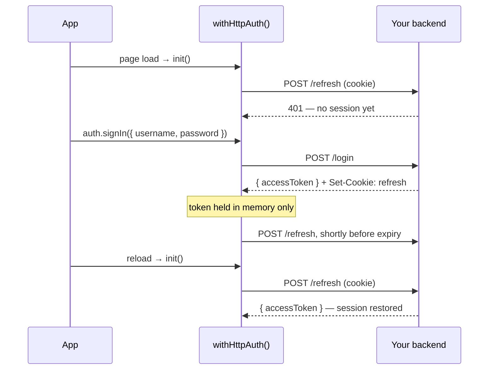

# Your own backend

`withHttpAuth()` adapts a backend you run yourself — Spring Boot, NestJS,
ASP.NET, Express — to the [`AuthProvider` port](../api/ports.mdx). Your
application shows its own login form; your backend checks the password and
issues the tokens.

```ts title="src/app/app.config.ts"
import { provideHttpClient, withInterceptors } from '@angular/common/http';
import { provideRouter } from '@angular/router';
import { authTokenInterceptor, provideAuth } from '@ismailza/ngx-auth-client';
import { withHttpAuth } from '@ismailza/ngx-auth-client/http';

export const appConfig: ApplicationConfig = {
  providers: [
    provideAuth(
      withHttpAuth({
        endpoints: {
          signIn: '/api/auth/login',
          refresh: '/api/auth/refresh',
          logout: '/api/auth/logout',
          profile: '/api/auth/me', // optional
        },
      }),
    ),
    provideHttpClient(withInterceptors([authTokenInterceptor])),
    provideRouter(routes),
  ],
};
```

No extra dependency: the adapter is built on `HttpClient`. `provideHttpClient()`
and `provideRouter()` are required.

## The backend contract

| Endpoint  | Request                               | Success response                                              | Refusal |
| --------- | ------------------------------------- | ------------------------------------------------------------- | ------- |
| `signIn`  | `POST`, credentials as JSON           | `{ accessToken, expiresIn? }` + sets the refresh-token cookie | `401`   |
| `refresh` | `POST`, no body, refresh cookie       | `{ accessToken, expiresIn? }`, optionally rotating the cookie | `401`   |
| `logout`  | `POST`, bearer token + refresh cookie | anything; must clear the cookie and revoke the refresh token  | —       |
| `profile` | `GET`, bearer token                   | the user profile                                              | —       |

`access_token`/`expires_in` and `token` are accepted too. For any other shape,
see [`mapTokenResponse`](#response-shapes).

The access token should be a **JWT**: the adapter decodes its payload to
populate `claims()` and `roles()`. It does not verify the signature, and doesn't
need to — the backend verifies the token on every request, and that is the check
that protects data.

A refusal means "wrong credentials" on `signIn` and "no session" on `refresh`,
where it signs the user out. Any other failure — a timeout, a `500`, a firewall
`403`, the network being down — is reported as an error and **leaves the
session alone**, so a flaky connection never looks like a logout, and a
validation error never looks like a wrong password.

Only `401` counts as a refusal by default. If your backend answers a missing
refresh cookie with `400`, say so:

```ts
withHttpAuth({ endpoints, rejectionStatuses: [400, 401] });
```

## The session lifecycle



- **On page load**, `init()` calls `refresh`. The browser sends the cookie, so
  an existing session is restored silently; with no cookie, the user is simply
  unauthenticated.
- **Before expiry**, the token is refreshed in the background, so `claims()`
  stays current even if the app makes no API call for a while. That happens
  `minTokenValidity` seconds (30 by default) ahead of expiry, but never before
  half the token's lifetime has passed and never less than 5 s after the last
  refresh — so a very short-lived token cannot cause a refresh loop.
  `getToken()` also refreshes on demand once that point is reached.
- **The client clock doesn't matter** when the backend sends `expiresIn`, or
  when the JWT carries both `iat` and `exp`: the lifetime is then measured
  between two server timestamps.
- **If a background refresh fails** for network reasons, it is retried every
  10 s. If the token expires before a retry succeeds, the session ends rather
  than appear valid with a dead token.
- **Concurrent calls share one refresh.** Five requests fired with an expiring
  token produce one `refresh` call, not five.

## The login page

`login()` — and therefore `authGuard` — navigates to `loginRoute` (`/login` by
default) with the page the user wanted in the `returnUrl` query parameter. The
login page calls `signIn()`:

```ts title="src/app/login/login.ts"
import { Component, inject, signal } from '@angular/core';
import { ActivatedRoute, Router } from '@angular/router';
import { AuthService, InvalidCredentialsError } from '@ismailza/ngx-auth-client';
import { sanitizeReturnUrl } from '@ismailza/ngx-auth-client/http';

@Component({
  selector: 'app-login',
  template: `
    <form (submit)="submit($event, username.value, password.value)">
      <label>Username <input #username name="username" autocomplete="username" required /></label>
      <label
        >Password
        <input #password name="password" type="password" autocomplete="current-password" required
      /></label>
      @if (error()) {
        <p role="alert">{{ error() }}</p>
      }
      <button type="submit" [disabled]="pending()">Sign in</button>
    </form>
  `,
})
export class Login {
  private readonly auth = inject(AuthService);
  private readonly router = inject(Router);
  private readonly route = inject(ActivatedRoute);

  protected readonly pending = signal(false);
  protected readonly error = signal<string | null>(null);

  async submit(event: Event, username: string, password: string) {
    event.preventDefault();
    this.pending.set(true);
    this.error.set(null);
    try {
      await this.auth.signIn({ username, password });
      const returnUrl = sanitizeReturnUrl(this.route.snapshot.queryParamMap.get('returnUrl'));
      await this.router.navigateByUrl(returnUrl);
    } catch (error) {
      this.error.set(
        error instanceof InvalidCredentialsError
          ? 'Wrong username or password.'
          : 'Sign-in is unavailable. Please try again.',
      );
    } finally {
      this.pending.set(false);
    }
  }
}
```

:::warning[Always sanitise the return URL]
`returnUrl` arrives in the query string, so anyone can craft a link that sets
it. [`sanitizeReturnUrl()`](../api/http.mdx#sanitizereturnurl) only lets
in-app paths through, which stops your login page from becoming an open
redirect.
:::

Extra fields — a one-time code, a tenant — are sent to the backend as-is:

```ts
await auth.signIn({ username, password, otp: '123456' });
```

Do **not** put `authGuard` on the login route itself.

## Logging out

```ts
await auth.logout(); // → postLogoutRoute, '/' by default
```

The session is cleared locally first, then `logout` is called. If that call
fails, the user is still signed out in this tab and navigated away, but
`logout()` rejects: the refresh cookie may have survived, so a reload could sign
them back in. Tell the user rather than ignoring it.

## Response shapes

Adapt the adapter to your backend instead of the other way around:

```ts
withHttpAuth({
  endpoints,
  // { "jwt": "…", "ttl": 900 }
  mapTokenResponse: (body) => {
    const { jwt, ttl } = body as { jwt: string; ttl: number };
    return { accessToken: jwt, expiresIn: ttl };
  },
  // { "sub": "…", "scope": "orders:read orders:write" }
  mapRoles: (claims) =>
    String(claims['scope'] ?? '')
      .split(' ')
      .filter(Boolean),
});
```

By default roles are read from a `roles` claim, falling back to Spring
Security's `authorities`.

**Opaque tokens.** If your access token is not a JWT, return `claims` yourself,
typically from user data in the same response:

```ts
mapTokenResponse: (body) => {
  const { token, expiresIn, user } = body as LoginResponse;
  return { accessToken: token, expiresIn, claims: { sub: user.id, roles: user.roles } };
},
```

## Capabilities

| Capability            | Available                        |
| --------------------- | -------------------------------- |
| `signIn()`            | always                           |
| `loadProfile()`       | when `endpoints.profile` is set  |
| `register()`          | no — build your own sign-up page |
| `updatePassword()`    | no                               |
| `accountManagement()` | no                               |

`AuthService.canSignIn()` and `canLoadProfile()` report this, so UI written
against `AuthService` adapts without knowing which adapter is configured.

## XSRF protection

Auth requests bypass interceptors, Angular's XSRF interceptor included, so the
adapter adds the header itself: on every same-origin `POST` it copies the
`XSRF-TOKEN` cookie into an `X-XSRF-TOKEN` header — the names Spring
Security's `CookieCsrfTokenRepository` and Angular both default to. The token is
never sent to another origin.

```ts
withHttpAuth({ endpoints, xsrf: { cookieName: 'CSRF', headerName: 'X-CSRF' } }); // other names
withHttpAuth({ endpoints, xsrf: false }); // no XSRF header
```

For other headers your interceptors would normally add — an API key, a tenant —
use `headers`:

```ts
withHttpAuth({ endpoints, headers: { 'X-Tenant': 'acme' } });
```

## Security checklist for the backend

The client side is only half of the design. On the server:

- Set the refresh cookie with **`HttpOnly`, `Secure`, `SameSite=Strict`** (or
  `Lax`), and scope its `Path` to the auth endpoints.
- **Rotate** the refresh token on every `refresh`, and revoke the whole family
  if an old one is reused.
- Keep access tokens **short-lived** (5–15 minutes).
- Revoke the refresh token server-side on `logout`, not just the cookie.
- With a cross-origin backend, allow credentials in CORS for your app's origin
  only — `withCredentials` is on by default for this reason.

## Things to know

- **Interceptors are bypassed.** Auth requests go straight to `HttpBackend`.
  This prevents a loop through `authTokenInterceptor`, but it also means your
  other interceptors — a base URL, for instance — don't apply. Give endpoint
  URLs exactly as they should be sent; the XSRF header and `headers` are
  handled [by the adapter](#xsrf-protection).
- **Apps under a sub-path** work: absolute `redirectUri`s lose the
  `<base href>` before they reach the router.
- **zone.js apps stay stable.** The refresh timer runs outside the Angular
  zone, so it never holds up `whenStable()` or service-worker registration.
- **Server-side rendering** is safe: `init()` makes no request on the server and
  the user is unauthenticated there, as with the Keycloak adapter.
- **Tabs aren't synchronised yet.** Logging out in one tab clears that tab;
  others sign out when their next refresh is refused.

→ [API reference](../api/http.mdx)
