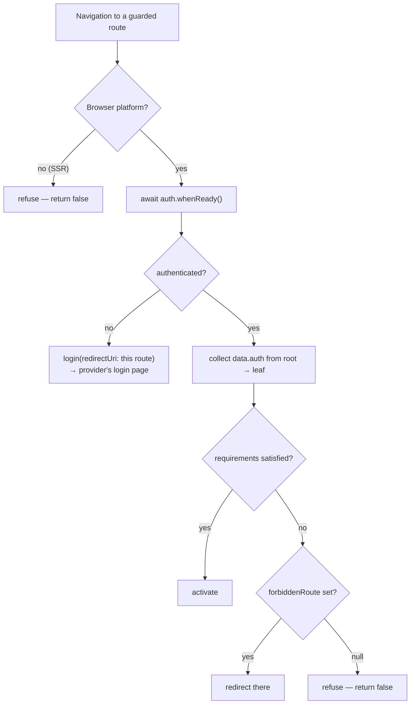

# Protecting routes

`authGuard` is a functional `CanActivateFn`. Add it to `canActivate` and, when a
route needs more than a signed-in user, declare the role requirement in
`data.auth`.

```ts title="src/app/app.routes.ts"
import { Routes } from '@angular/router';
import { authGuard, AuthRouteData } from '@ismailza/ngx-auth-client';

export const routes: Routes = [
  {
    path: 'dashboard',
    canActivate: [authGuard],
    loadComponent: () => import('./dashboard').then((m) => m.Dashboard),
  },
  {
    path: 'admin',
    canActivate: [authGuard],
    data: { auth: { anyOf: ['admin', 'owner'] } } satisfies AuthRouteData,
    loadComponent: () => import('./admin').then((m) => m.Admin),
  },
];
```

## What the guard decides



Three things are worth drawing out.

**It awaits readiness first.** A guard that ran before the session was restored
would bounce signed-in users to the login page on every hard refresh.
`await auth.whenReady()` makes the decision against settled state.

**Unauthenticated users come back where they started.** The guard calls
`login()` with the requested URL as the redirect target, so the round-trip
through the identity provider is invisible:

```ts
await auth.login({ redirectUri: `${globalThis.location.origin}${state.url}` });
```

**Missing roles are a different outcome from missing authentication.** Signing in
again wouldn't grant a role, so those users go to
[`forbiddenRoute`](./configuration.mdx#forbiddenroute) rather than to the login
page.

## Role requirements

`data.auth` accepts two fields:

| Field   | Meaning                             | Satisfied when            |
| ------- | ----------------------------------- | ------------------------- |
| `anyOf` | The user must hold **at least one** | Any listed role is held   |
| `allOf` | The user must hold **every one**    | All listed roles are held |

```ts
// at least one of
data: { auth: { anyOf: ['admin', 'owner'] } } satisfies AuthRouteData;

// all of
data: { auth: { allOf: ['admin', 'finance'] } } satisfies AuthRouteData;

// both conditions apply
data: { auth: { anyOf: ['admin', 'owner'], allOf: ['mfa-verified'] } } satisfies AuthRouteData;
```

Omit `data.auth` to require authentication only.

:::tip[Use `satisfies AuthRouteData`]
`Route['data']` is typed as `Record<string, any>`, so a typo like `{ auth: { anyof: [...] } }`
compiles happily and silently protects nothing. `satisfies AuthRouteData` gets
you the type check without widening the property's type.
:::

## Requirements accumulate down the tree

The guard walks from the root route to the one being activated and collects every
`data.auth` it finds. **A requirement on a parent route applies to all of its
children** — so a protected section is configured once, at its root.

```ts
export const routes: Routes = [
  {
    path: 'admin',
    canActivate: [authGuard],
    data: { auth: { anyOf: ['admin', 'owner'] } } satisfies AuthRouteData,
    children: [
      // requires: anyOf ['admin', 'owner']
      { path: 'users', loadComponent: () => import('./users').then((m) => m.Users) },

      // requires: anyOf ['admin', 'owner'] AND allOf ['finance']
      {
        path: 'billing',
        data: { auth: { allOf: ['finance'] } } satisfies AuthRouteData,
        loadComponent: () => import('./billing').then((m) => m.Billing),
      },
    ],
  },
];
```

Note that `canActivate` sits on the parent only. Angular runs a parent's guard for
any child activation, so the whole subtree is covered.

### Two `anyOf` groups are two conditions

Each `anyOf` stays a separate group rather than being merged into one list. Two
ancestors each demanding "one of these" are two independent conditions:

```ts
{
  path: 'reports',
  data: { auth: { anyOf: ['staff', 'contractor'] } } satisfies AuthRouteData,
  children: [
    {
      path: 'financial',
      data: { auth: { anyOf: ['finance', 'exec'] } } satisfies AuthRouteData,
      // …
    },
  ],
}
```

Reaching `reports/financial` requires one role from **each** group. A user with
only `staff` is refused. Flattening the two into
`['staff', 'contractor', 'finance', 'exec']` would let a lone `staff` role satisfy
both — which is not what either route asked for.

`allOf` sets, by contrast, are simply unioned: every role in every `allOf` along
the path must be held.

## Hiding the links too

A guard stops navigation; it doesn't stop a dead link from appearing in your
menu. Pair it with a role check in the template:

```ts
@Component({
  template: `
    @if (canAdminister()) {
      <a routerLink="/admin">Admin</a>
    }
  `,
})
export class Nav {
  private readonly auth = inject(AuthService);
  protected readonly canAdminister = computed(() => this.auth.hasAnyRole(['admin', 'owner']));
}
```

The requirement is now written twice, which is worth avoiding for anything
non-trivial — export it from one place:

```ts title="src/app/auth-requirements.ts"
export const ADMIN_AREA = { anyOf: ['admin', 'owner'] } as const;
```

```ts
data: { auth: ADMIN_AREA } satisfies AuthRouteData;
```

```ts
protected readonly canAdminister = computed(() =>
  this.auth.hasAnyRole(ADMIN_AREA.anyOf),
);
```

## Guarding lazy-loaded routes

`authGuard` returns a promise, and Angular awaits it before loading the route's
bundle. A user without the required roles never downloads the chunk:

```ts
{
  path: 'admin',
  canActivate: [authGuard],
  data: { auth: { anyOf: ['admin'] } } satisfies AuthRouteData,
  loadChildren: () => import('./admin/routes').then((m) => m.routes),
}
```

This is a bundle-size benefit, not a security one — the chunk is still served by
your web server to anyone who requests its URL directly.

## Child routes and `canActivateChild`

`authGuard` is a `CanActivateFn`. Angular's `canActivateChild` expects the same
signature, so it can be used there too:

```ts
{
  path: 'admin',
  canActivateChild: [authGuard],
  data: { auth: { anyOf: ['admin'] } } satisfies AuthRouteData,
  children: [ /* … */ ],
}
```

Use `canActivate` when the parent route renders something itself, and
`canActivateChild` when it's a pathless or purely structural route whose children
are the real destinations.

## On the server, the guard refuses

Under SSR the guard returns `false` without attempting a redirect. Tokens live in
memory only, so the server has no session to evaluate — and rendering protected
content into a response that might be cached would leak it.

Protected routes therefore render nothing server-side and resolve on the client.
See [Server-side rendering](./server-side-rendering.mdx).

## Testing guarded routes

Use the fake adapter and a real router:

```ts
TestBed.configureTestingModule({
  providers: [
    provideAuth(withFakeAuth({ authenticated: true, roles: ['admin'] })),
    provideRouter(routes),
  ],
});

const router = TestBed.inject(Router);
expect(await router.navigate(['/admin'])).toBe(true);
```

See [Testing](./testing.mdx#guards) for asserting the redirect and login paths.

## Next

- [Configuration](./configuration.mdx#forbiddenroute) — where refused users go
- [`authGuard` reference](../api/guards.mdx) — the guard and the requirement helpers
- [Reading auth state](./auth-state.mdx#checking-roles) — the same checks in components
