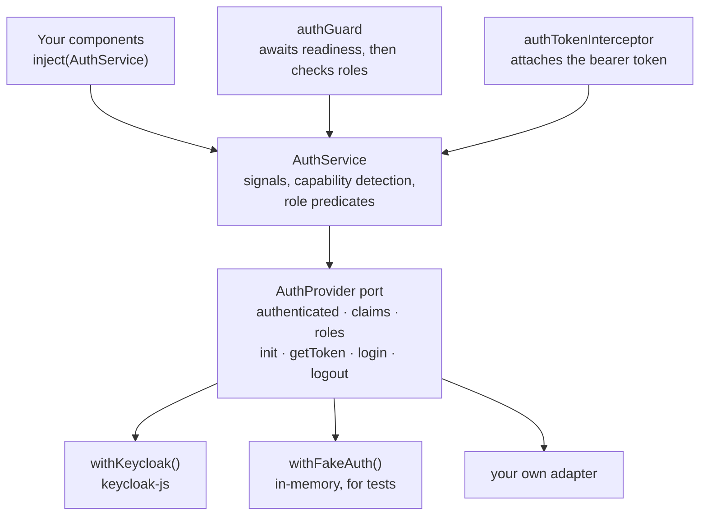

# Introduction

Angular is signals-first and zoneless by default. Reading authentication state
should look like reading any other piece of state in your application.

Today it doesn't. Authentication state lives on the identity provider's client
object as plain getters, and deriving reactive state from it is left to you.
Every application ends up writing the same derivation layer.

**`ngx-auth-client` writes that layer once and gives you the state directly.**

```ts
@Component({
  template: `@if (auth.authenticated()) {
    Hello {{ auth.claims()?.name }}
  }`,
})
export class Header {
  protected readonly auth = inject(AuthService);
}
```

That's the whole integration for a component. The setup is one provider call:

```ts
bootstrapApplication(App, {
  providers: [provideAuth(withKeycloak({ url, realm, clientId }))],
});
```

## Why signals matter here

In a zoneless application, getter-based state isn't merely inconvenient — it's
invisible:

```ts
@if (keycloak.authenticated) { ... }   // ✗ never updates — nothing schedules CD
@if (auth.authenticated()) { ... }     // ✓ updates on login, logout, refresh
```

Zone.js used to paper over this by re-rendering after every async task. Without
it, state read through a getter simply doesn't participate in change detection.

## The shape of the library



Your application code depends on `AuthService`. `AuthService` depends on the
`AuthProvider` port. Only the adapter knows which identity provider you use — so
swapping or upgrading it stays a one-file change.

## What it does

| Concern               | What the library provides                                                                                    |
| --------------------- | ------------------------------------------------------------------------------------------------------------ |
| **Auth state**        | `authenticated`, `claims`, `roles`, `profile` — all signals                                                  |
| **Route guards**      | A functional `authGuard` with role requirements that accumulate down the route tree                          |
| **Bearer tokens**     | An interceptor that attaches the token to an **allowlist** of requests, refreshing it first when near expiry |
| **Roles**             | Normalised to `string[]` by the adapter, whatever shape the provider uses                                    |
| **Capabilities**      | Registration, account console, password change and profile loading — feature-detected, never faked           |
| **Testing**           | A real in-memory adapter, so no test needs a Keycloak server                                                 |
| **Provider-agnostic** | A small port at the auth boundary, with a Keycloak adapter shipped on top                                    |

## What it deliberately does not do

- **It stores no tokens.** Nothing is written to `localStorage` or
  `sessionStorage`. Session continuity comes from the provider's own SSO cookie
  via silent re-authentication. See [Security](./guides/security.mdx).
- **It renders nothing.** No login pages, no toasts, no redirect UI. The
  provider's hosted pages handle authentication; your application handles
  everything else.
- **It does not register the interceptor for you.** Order matters relative to
  your other interceptors, so you wire it up in `withInterceptors()` yourself.
- **It does not block bootstrap.** `init()` starts during bootstrap and
  `authGuard` awaits it, so unprotected shell UI paints immediately while
  protected routes stay safe.
- **It brings no identity-provider dependency in the core.** `keycloak-js` is an
  _optional_ peer dependency, needed only by the Keycloak adapter.

## Design principles

**State is signals, operations are promises.** The dividing line is state versus
action. `authenticated` and `roles` are state, so they're signals. `getToken()`
performs a refresh — that's an action, so it's a promise.

**The port stays honest.** Not every provider hosts a sign-up flow or an account
console. Rather than forcing adapters to stub methods they can't support,
optional features are declared as [capabilities](./guides/capabilities.mdx) the
core feature-detects, with a matching `can*` signal so you can hide UI you
cannot deliver.

**Role normalisation belongs to the adapter.** Providers disagree about where
roles live — Keycloak splits them across `realm_access` and `resource_access`,
Auth0 uses a namespaced custom claim, Cognito uses `cognito:groups`. The adapter
resolves that; the core only ever sees `string[]`.

**Security decisions fail closed.** The bearer allowlist attaches no token when
its pattern matches nothing, rather than leaking one to an unintended host. The
guard refuses activation on the server rather than rendering protected content
into a response that might be cached.

## When you should use something else

- **You need certified, generic OIDC** across arbitrary providers →
  [`angular-auth-oidc-client`](https://github.com/damienbod/angular-auth-oidc-client).
  It is OpenID-certified, mature, and the right call if protocol breadth is your
  priority.
- **You're happy deriving state from events yourself** →
  [`keycloak-angular`](https://github.com/mauriciovigolo/keycloak-angular) is
  well maintained and closer to the metal.
- **You're on Auth0 or Entra ID today** → use their first-party SDKs. Adapters
  here are on the roadmap, but shipped beats planned.

## Compatibility

Supports **Angular 17 through 22**. Every one of those majors is verified on each
push against the packed tarball — type-checked with `ngc`, bundled through a
production build, and executed in Node, for all three entry points. The upper
bound is deliberate: a new major is added only once it has been validated.

See [Installation](./getting-started/installation.mdx#requirements) for the full
requirements.

## Next steps

- [Installation](./getting-started/installation.mdx) — add the package and wire up the providers
- [Quick start](./getting-started/quick-start.mdx) — a protected route in five minutes
- [Configuration](./guides/configuration.mdx) — every `provideAuth()` option
